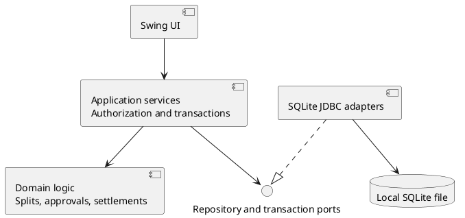

# SplitSmart Lab 7: Alternative Desktop Architecture

## Purpose and scope

This proposal explores one Java 21 Maven application with a Swing interface, business logic, and embedded SQLite storage. It is an alternative to the supplied Spec Kit base architecture of a Swing client, a separate Spring Boot REST service, and PostgreSQL. It does not replace that plan or implement either design.

The governing sources are [the feature specification](spec.md) and [the constitution](../../.specify/memory/constitution.md). The full product still requires a mainly web-based application plus Android and iOS, consistent shared information, verified email accounts, and the other specified features. A local desktop MVP is a limited implementation stage, not completion of those requirements.

For this proposal, the Lab 7 instructions resolve the specification's open MVP questions: USD only; exact money calculations; largest-remainder rounding with ties broken by ascending account ID; and one manager other than the submitter approving by default, with configurable multiple approvals. These are MVP design decisions, not edits to the full-product specification. Other choices below are proposed behavior for review before implementation.

## Components and dependencies

Use a single Maven project and one JVM process. Packages provide boundaries without requiring separate deployments.

| Component | Responsibilities | Dependencies |
|---|---|---|
| Swing UI | Sign-in, group and invitation screens, expense entry, approval queue, balances, payment history, reports; present validation errors | Application services and view models |
| Application services | Authenticate actors, check permissions, coordinate use cases and database transactions | Domain objects, repository interfaces, transaction interface |
| Domain/business logic | Membership rules, exact splits, approval transitions, settlement validation and balance calculation | Java types, including `BigDecimal`; no Swing or JDBC |
| Storage adapters | Implement repositories with parameterized JDBC queries, SQLite constraints, schema migrations and transaction handling | SQLite JDBC driver and domain data |
| Bootstrap | Select data directory, migrate schema, wire services and adapters, open UI | All layers for construction only |

Repository interfaces belong on the business side of the boundary. The UI must not execute SQL or calculate balances. Services must enforce authorization even when a screen hides an action. Slow database work runs off Swing's event dispatch thread; UI updates return to that thread.

## How the application runs

The proposed Maven build targets Java 21, uses JUnit 5, and packages the application with its SQLite JDBC dependency. Once implemented, the intended workflow is `mvn test`, `mvn package`, then launching the packaged desktop application with Java 21 on a machine with a graphical display. These are future build expectations, not commands validated against the current specification-only repository.

At startup, bootstrap opens a database in a configurable local application-data directory outside the installation directory, enables foreign keys on every connection, and applies versioned migrations transactionally. A schema version newer than the application understands causes a clear startup error. No REST server, PostgreSQL service, or network database is needed. The MVP supports one running application instance per database, with a lock preventing a second instance from opening the same store for normal use.

Accounts share that local database through sequential sign-in on the same installation. Closing and reopening the app preserves expenses, decisions and payments. Business operations use short transactions and roll back on failure. Backups use SQLite's supported backup mechanism, or copy the database only after all connections close; copying an active file alone may miss journal data. Restore is explicit and must not silently merge databases.

## Money and splitting rules

All amounts are USD. Parse decimal input directly into `BigDecimal`, never through `float` or `double`. Accept positive amounts representable as whole cents; reject excess fractional cents and amounts outside the supported integer storage range. Persist money as integer cents, using checked conversions. SQLite `REAL` is not used for money. Store percentage inputs as canonical decimal text to preserve their exact values.

Require at least one distinct, current group participant. The payer may be included or excluded. Equal splits give every selected participant the same weight. Percentage splits require nonnegative values whose exact sum is 100.

Calculate each ideal share in cents from exact decimal weights. Take its whole-cent floor and retain the exact fractional remainder. Distribute the remaining cents in descending remainder order, breaking ties by ascending immutable numeric account ID. Use exact quotient/remainder operations rather than an arbitrarily rounded division that could reorder ties. Persist the final allocated shares and verify that their sum equals the expense amount.

For example, splitting $10.00 equally among accounts 2, 7 and 11 produces $3.34, $3.33 and $3.33 respectively. Zero shares are permitted for zero-percent participants. A payer's own share creates no debt to themselves.

## Storage model

| Records | Important persisted data and constraints |
|---|---|
| Account | Stable numeric ID, unique normalized email, salted adaptive password hash, verification status and timestamps; never plaintext passwords |
| Group, membership, invitation | Group ID, manager role, invitation and acceptance status, membership dates; only accepted members participate |
| Approval policy | Group policy version and ordered required manager slots; default is one eligible manager other than the submitter |
| Expense | Group, submitter, payer, positive total cents, USD, expense date, description, split method, version, status, creation/submission dates |
| Expense share | Expense version, participant ID, exact percentage where applicable, allocated cents; unique participant per version |
| Required approval and decision | Expense version, policy snapshot, step order, assigned manager, decision, reason and decision timestamp; one terminal decision per required slot |
| Payment | Group, debtor, creditor, positive amount cents, USD, payment date, recording actor, creation time and unique request ID |
| Audit event | Actor, entity and version, action, timestamp and relevant change details; committed with the corresponding operation |

Foreign keys, uniqueness and row-level checks protect basic integrity. Services enforce cross-row rules such as membership, share totals, required approvals and outstanding balances within the same transaction. Index group IDs, participant IDs, statuses and report dates. Retain membership and account history referenced by financial records rather than cascading deletes through the history.

### Expense submission and approvals

On submission, validate the actor, payer, participants and split. In one transaction, store the immutable submitted expense version and its shares, snapshot the approval policy, assign eligible managers, and mark it pending. The default assigns one manager who is not the submitter. For multiple approvals, the proposed policy is an ordered list of distinct managers, all of whom must approve their assigned step. No submitter may fill a slot. If too few eligible managers exist, reject submission with an explanation; do not auto-approve or silently reduce the requirement.

Each decision records its actor, expense version, step, result and timestamp. Check the current pending status, step order and manager authorization inside the transaction. A rejection makes that version rejected. Partial approval leaves it pending. The final required approval changes it to approved atomically with the decision and audit event. Uniqueness and conditional state/version updates prevent duplicate or stale decisions. Group policy changes apply to future submissions, not expenses already under review. A required manager's departure blocks that review until an explicit audited withdrawal and resubmission under an eligible policy; it never bypasses an approval.

Submitted and approved versions cannot be edited in place. A pending or rejected expense may be superseded by a new submission with fresh approvals; prior versions remain in history. Corrections to approved financial records require a separately reviewed reversal/correction workflow, outside this MVP. Pending, rejected, withdrawn and superseded versions contribute nothing to balances.

### Balances and payments

Treat approved expense shares and recorded payments as the source of truth. Derive balances rather than maintaining a second editable balance total. For each approved expense, each participant other than its payer owes that payer their allocated cents. Net opposing debts for each pair within a group. Do not offset debts between unrelated groups or currencies.

A payment records an already-made transfer; the app does not move money. In a write transaction, authorize the recording member, calculate the current positive net debt from debtor to creditor, and require a positive payment no larger than that debt. Insert the payment and audit event together, then commit. Its amount reduces that directed debt and appears in payment history. Use a unique request ID to prevent duplicate recording when a UI action is retried.

Serialize writes using SQLite transaction locking so a second settlement cannot validate against the same stale balance. Report lock contention as a retryable error without partial writes. Preserve payment records; an error correction must be explicit and audited rather than deleting history. Reports use a consistent read snapshot and distinguish date-filtered activity from the current balance or an explicitly requested historical balance.

## Requirement coverage and limits

“Supported” below describes architectural capability, not implemented or tested compliance.

| Requirements | Desktop MVP assessment |
|---|---|
| FR-001 accounts | Local registration and password authentication are feasible. Real email verification and verified password reset need an external trusted delivery/verification mechanism. A local checkbox or administrator reset does not satisfy the specified email verification flow; this remains partial. |
| FR-002, NFR-005 privacy | Services can restrict records by account and accepted membership. Local file permissions and protected backups are required. Anyone controlling the OS or database file can bypass application controls; this is unsuitable as a strong trust boundary among mutually untrusted device owners. Compliance needs security testing and an explicit threat model. |
| FR-003 groups | Local groups, invitations and explicit acceptance can be stored, with users signing in sequentially. Remote invitation delivery and joining from another computer are not provided. |
| FR-004, FR-005, NFR-004 expenses and money | Supported for the USD MVP with exact splits, deterministic rounding, selected participants and optional payer participation. This does not establish full-product multicurrency policy. |
| FR-008, FR-009 approvals | Supported locally through persisted decisions, policy snapshots, distinct non-submitter managers and all-required approval gating. |
| FR-010, FR-011 balances and payments | Supported within the local database, including overpayment prevention and history. Recording a payment is not bank integration. |
| FR-012, FR-013 reports | Local summaries and date/option filters are feasible, subject to authorization. |
| NFR-006 history | Expense versions, decisions, payments and audit events support traceability. Local audit data is not tamper-proof against a machine administrator. |
| FR-006 receipts | Deferred from the MVP. SQLite could store attachment metadata and controlled local image files or blobs later; the feature is not delivered by this proposal. |
| FR-007 notifications | Deferred. A later local inbox could show pending submissions on sign-in, but this would not establish immediate notifications to users on other computers. |
| FR-014, NFR-001, SC-006 platforms | Not met: Swing and a local database provide neither a website nor Android/iOS clients or cross-platform shared state. |
| NFR-002, SC-001 usability | Unproven until the specified first-time-user study demonstrates at least 90% task completion without help. |
| NFR-003, SC-005 performance | Plausible with indexes and suitable queries, but unproven until at least 95% of report requests complete within 2 seconds against 10,000 expense/payment records under agreed conditions. |

### Shared access from different computers

Each installation has its own database, account IDs and history. Changes on one computer do not appear on another. Passing around copies is a backup/transfer operation, not synchronization; independent copies can diverge, duplicate IDs and contain conflicting approvals or payments. A shared network drive or consumer file-sync folder is not a supported substitute for a transactional server and must not host an actively shared SQLite file.

The design suits a local demonstration or a small trusted group using one computer sequentially. It cannot provide the base architecture's central authority for concurrent remote clients. It also cannot establish independent identity simply because two local accounts supplied different passwords.

## Comparison and future direction

| Concern | Single desktop app with SQLite | Swing + Spring Boot REST + PostgreSQL base |
|---|---|---|
| Operation | One process and local data file; works offline for local functions | Client plus server and database deployment |
| Shared state | Limited to one local installation | Central service can coordinate remote clients |
| Security authority | Application checks depend on control of the local machine | Service can enforce rules independently of client machines |
| Development | Fewer deployment and network concerns; embedded storage tests | Additional API, deployment and service integration work |
| Web/mobile path | Requires a shared service and new clients | REST service offers a possible foundation; clients and validation still required |

Keep the domain logic free of Swing and SQLite so it can later run behind a service. Moving to the full product still requires server-side authentication and authorization, verified email workflows, globally meaningful identifiers, data migration, transactional shared storage, API contracts, receipt handling, immediate notification delivery and web/mobile interfaces. SQLite repositories would be replaced or adapted, and service transaction boundaries would be revalidated. Offline synchronization, if desired, needs its own conflict and identity design; it does not follow automatically from layered code.

The constitution requires a reviewed and approved platform plan before claiming full-product completion. This alternative preserves those obligations and proposes no requirement deletion or amendment.

## Proposed validation before accepting an implementation

Use JUnit 5 for domain tests without a GUI and integration tests against temporary SQLite databases. Verify equal and percentage splits, exact totals, account-ID ties, zero percentages, invalid inputs and overflow. Exercise the specification's SC-002 through SC-004 with pending/rejected expenses, every required approval, self-approval denial, stale decisions, rollback and duplicate/overpayment attempts. Close and reopen the database to verify persistence and audit history.

Test authorized and blocked access for every record type (SC-007), invitation acceptance, departure rules, policy snapshots, report boundaries, migration and backup restoration. Use controlled concurrency tests to verify payment serialization. Validate the actual Swing workflow separately, then run the specified usability and 10,000-record performance evaluations. Email verification, remote sharing and web/mobile consistency cannot be marked passed by local desktop tests. Keep requirement-to-test links and review the design, PlantUML diagrams and results with a person before acceptance.

No application behavior, build, performance target or acceptance test is claimed as verified by this document.
